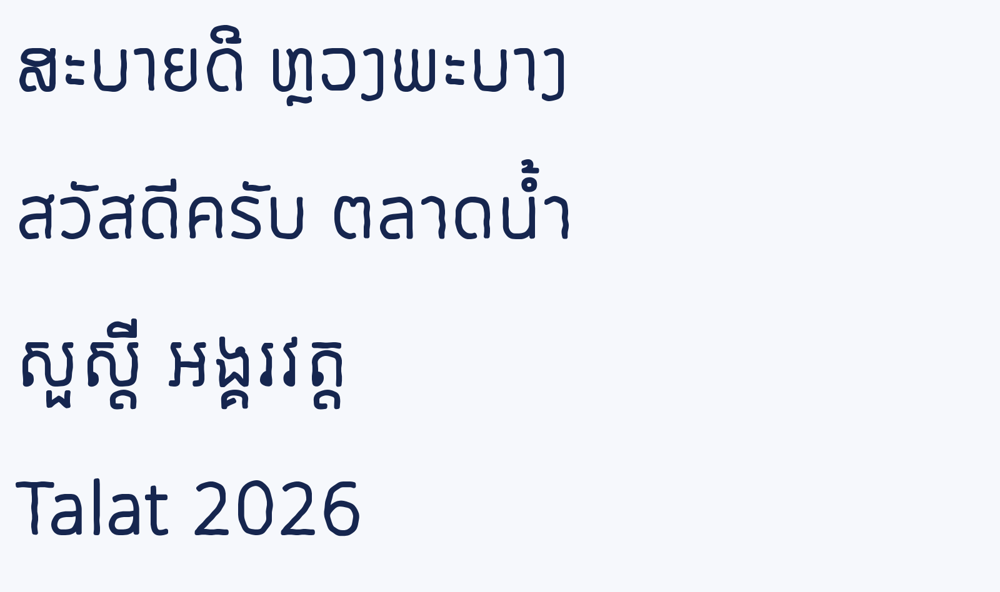
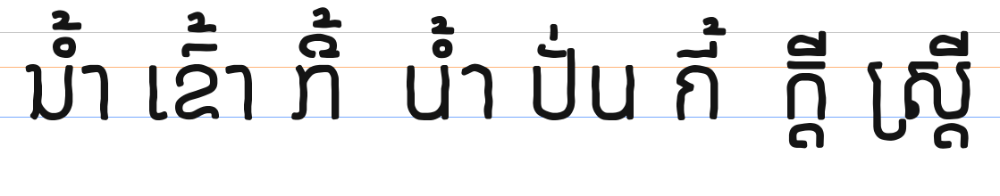

# Talat ຕະຫຼາດ

**A free handwritten display font for Lao, Thai, Khmer and English.** Free and open source under the [SIL Open Font License 1.1](OFL.txt). **Status: beta (version 0.100).**

[Try it online](https://rcampbellbassac.github.io/Talat/) · [Download](https://github.com/rcampbellbassac/Talat/releases/latest/download/Talat.zip) · [ລາວ](#ລາວ) · [ไทย](#ไทย) · [ខ្មែរ](#ខ្មែរ)

The name Talat means market: marker lettering on price cards and stalls. The letters were drawn with a simulated marker on the thin Noto designs, inspired by Itim, Mali, Caveat.

> **Beta.** This font is in beta. It was generated from Noto fonts with a simulated pen or brush, so some letters still need hand finishing. Your feedback helps make it better.

## Install

1. Download the zip file from the latest release.
2. Unzip it and open the TTF file.
3. Click Install. The font is now in Word, LibreOffice, Canva and your other apps.

For websites, use the WOFF2 file.

## How it is made

`recipe.json` is the whole design: a pen or brush recipe applied to the thin weights of Noto Sans Lao (looped or plain), Noto Sans Thai (looped or plain), Noto Sans Khmer and Noto Sans (or the serif versions). `scripts/build.py` rebuilds the font with the vendored `fontlab_mcp` modules; Noto's OpenType layout (mark positioning, Thai/Lao mark stacking, Khmer subscripts) is kept, and anchors move with the outlines.

## License and credits

Designed by Robert Martin Campbell. Letters derived from Noto Sans Lao, Noto Sans Thai, Noto Sans Khmer and Noto Sans by the Noto Project Authors. Free to use, share and change under the SIL Open Font License 1.1, including for commercial work. See [FONTLOG.txt](FONTLOG.txt).

---

## ລາວ

**ຟອນພາດຫົວແບບລາຍມືຂຽນຟຣີ ສຳລັບພາສາລາວ, ໄທ, ຂະເໝນ ແລະ ອັງກິດ.**

ຊື່ Talat (ຕະຫຼາດ) ໝາຍເຖິງຕະຫຼາດ ຄືກັບຕົວໜັງສືບິກເຟິດທີ່ຂຽນໃສ່ປ້າຍລາຄາຕາມຮ້ານຄ້າ. ຕົວອັກສອນຖືກວາດດ້ວຍການຈຳລອງບິກເຟິດ (Marker) ບົນໂຄງສ້າງຟອນ Noto ແບບບາງ ໂດຍໄດ້ແຮງບັນດານໃຈຈາກ Itim, Mali ແລະ Caveat.

> ຟອນນີ້ຍັງຢູ່ໃນລຸ້ນທົດລອງ ໂດຍສ້າງຈາກຟອນ Noto ດ້ວຍການຈຳລອງລາຍເສັ້ນປາກກາ ຫຼື ຟອຍທາສີ ຕົວອັກສອນບາງຕົວຈຶ່ງຍັງຕ້ອງປັບແຕ່ງເພີ່ມເຕີມ ຄຳແນະນຳຂອງທ່ານຈະຊ່ວຍໃຫ້ຟອນນີ້ດີຂຶ້ນ.

1. ດາວໂຫຼດໄຟລ໌ zip ຈາກລຸ້ນຫຼ້າສຸດ.
2. ແຕກໄຟລ໌ zip ແລ້ວເປີດໄຟລ໌ TTF.
3. ກົດຕິດຕັ້ງ (Install) ແລ້ວຟອນຈະພ້ອມໃຊ້ໃນ Word, LibreOffice, Canva ແລະ ໂປຣແກຣມອື່ນໆທັນທີ.

ໃຊ້ງານ, ແບ່ງປັນ ແລະ ດັດແປງໄດ້ຟຣີພາຍໃຕ້ສັນຍາອະນຸຍາດ SIL Open Font License 1.1 ລວມເຖິງວຽກການຄ້າ.

ຂໍ້ຄວາມພາສາລາວ, ໄທ ແລະ ຂະເໝນໃນໜ້ານີ້ແປໂດຍຜູ້ຊ່ວຍ AI ແລະ ຍັງບໍ່ທັນໄດ້ຮັບການກວດກາຈາກເຈົ້າຂອງພາສາ.

---

## ไทย

**ฟอนต์พาดหัวแนวลายมือเขียนฟรี สำหรับภาษาลาว ไทย เขมร และอังกฤษ**

ชื่อ Talat (ຕະຫຼາດ) หมายถึงตลาด สื่อถึงตัวหนังสือปากกามาร์กเกอร์บนป้ายราคาตามแผงค้า ตัวอักษรวาดขึ้นด้วยการจำลองปากกามาร์กเกอร์บนโครงสร้างฟอนต์ Noto แบบบาง ได้แรงบันดาลใจจาก Itim, Mali และ Caveat

> ฟอนต์นี้อยู่ในรุ่นทดสอบ สร้างขึ้นจากฟอนต์ Noto ด้วยการจำลองเส้นปากกาหรือพู่กัน ตัวอักษรบางตัวจึงยังต้องเก็บรายละเอียดด้วยมือเพิ่มเติม ความคิดเห็นของคุณจะช่วยให้ฟอนต์นี้ดียิ่งขึ้น

1. ดาวน์โหลดไฟล์ zip จากรุ่นล่าสุด
2. แตกไฟล์ zip แล้วเปิดไฟล์ TTF
3. คลิก ติดตั้ง (Install) ฟอนต์จะพร้อมใช้งานใน Word, LibreOffice, Canva และแอปอื่นๆ ทันที

ใช้งาน แชร์ และดัดแปลงได้ฟรีภายใต้สัญญาอนุญาต SIL Open Font License 1.1 รวมถึงงานเชิงพาณิชย์

ข้อความภาษาลาว ไทย และเขมรในหน้านี้แปลโดยผู้ช่วย AI และยังไม่ได้รับการตรวจทานจากเจ้าของภาษา

---

## ខ្មែរ

**ពុម្ពអក្សរក្បាច់បែបសរសេរដៃឥតគិតថ្លៃ សម្រាប់ភាសាឡាវ ថៃ ខ្មែរ និងអង់គ្លេស។**

ឈ្មោះ Talat (ຕະຫຼາດ) មានន័យថាផ្សារ គឺអក្សរហ្វឺតនៅលើស្លាកតម្លៃនិងតូបលក់ដូរ។ តួអក្សរត្រូវបានគូរដោយត្រាប់តាមប៊ិចហ្វឺតនៅលើទម្រង់ស្ដើងនៃពុម្ពអក្សរ Noto ដោយទទួលការបំផុសគំនិតពី Itim, Mali និង Caveat។

> ពុម្ពអក្សរនេះស្ថិតក្នុងកំណែសាកល្បងនៅឡើយ។ វាត្រូវបានបង្កើតឡើងពីពុម្ពអក្សរ Noto ដោយប្រើបច្ចេកទេសត្រាប់តាមគំនូសប៊ិច ឬជក់ ដូច្នេះអក្សរខ្លះនៅត្រូវការកែសម្រួលដោយដៃបន្ថែមទៀត។ មតិយោបល់របស់អ្នកជួយឱ្យពុម្ពអក្សរនេះកាន់តែប្រសើរឡើង។

1. ទាញយកឯកសារ zip ពីកំណែចុងក្រោយបំផុត។
2. ពន្លាឯកសារ zip រួចបើកឯកសារ TTF។
3. ចុចដំឡើង (Install)។ ឥឡូវនេះអ្នកអាចប្រើពុម្ពអក្សរនេះក្នុង Word, LibreOffice, Canva និងកម្មវិធីផ្សេងទៀតបានហើយ។

អាចប្រើប្រាស់ ចែករំលែក និងកែប្រែបានដោយឥតគិតថ្លៃក្រោមអាជ្ញាប័ណ្ណ SIL Open Font License 1.1 រួមទាំងសម្រាប់ការងារពាណិជ្ជកម្មផងដែរ។

អត្ថបទភាសាឡាវ ថៃ និងខ្មែរនៅលើទំព័រនេះ ត្រូវបានបកប្រែដោយជំនួយការ AI ហើយមិនទាន់ទទួលបានការត្រួតពិនិត្យដោយជនជាតិដើមនៅឡើយទេ។
